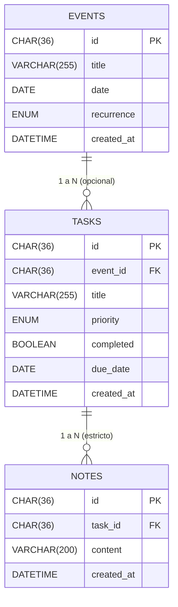

# CLI-Agenda

Aplicación de consola en Java 25 para la gestión integral de tareas, notas y eventos, con persistencia en MySQL 8.0, contenerizada con Docker Compose y ejecutable tanto desde el IDE como dentro de Docker.

---

## 📑 Tabla de contenidos

1. [🏛️ Decisiones de diseño y arquitectura](#️-decisiones-de-diseño-y-arquitectura)
   - [1. Dominio y Modelado (Java / DDD)](#1-dominio-y-modelado-java--ddd)
     - [1.1. Value Objects](#11-value-objects-en-lugar-de-tipos-primitivos)
     - [1.2. DTOs](#12-dtos-entre-el-servicio-y-la-cli)
     - [1.3. UUID, restore y UUIDv7](#13-identidad-con-uuid-método-restore-y-análisis-de-uuidv7)
     - [1.4. Relación Event → Task](#14-relación-event--task-sin-alterar-el-modelo-task)
   - [2. Arquitectura y Patrones de Diseño](#2-arquitectura-y-patrones-de-diseño)
     - [2.1. Descarte de Observer (KISS / YAGNI)](#21-descarte-del-patrón-observer-frente-a-consulta-directa-kiss--yagni)
     - [2.2. Interfaz Repository y caché InRam](#22-interfaz-repository-y-conservación-de-inram)
     - [2.3. Inyección de dependencias y Composition Root (AppInitializer)](#23-inyección-de-dependencias-y-composition-root-con-appinitializer)
     - [2.4. Singleton (ConnectionFactory)](#24-patrón-singleton-en-connectionfactory)
   - [3. Infraestructura y DevOps](#3-infraestructura-y-devops)
     - [3.1. Ejecución dual (IDE vs Docker)](#31-enfoque-de-ejecución-dual-ide-vs-docker-completo)
     - [3.2. Docker Multi-stage](#32-imagen-docker-multi-stage)
     - [3.3. Persistencia con volúmenes](#33-ciclo-de-vida-y-persistencia-con-volúmenes-docker)
2. [🗃️ Modelo de datos](#️-modelo-de-datos)
3. [🧩 Patrones detectados por IA](#-patrones-detectados-por-ia)
4. [🚀 Puesta en marcha y comandos útiles](#-puesta-en-marcha-y-comandos-útiles)
   - [Requisitos previos](#requisitos-previos)
   - [Configuración inicial de credenciales](#configuración-inicial-de-credenciales)
   - [Comandos útiles](#comandos-útiles)

---

## 🏛️ Decisiones de diseño y arquitectura

---

### 1. Dominio y Modelado (Java / DDD)

#### 1.1. Value Objects en lugar de tipos primitivos

En lugar de representar los datos del dominio con primitivos sueltos (`String`, `LocalDate`), cada concepto con reglas de negocio propias se modeló como un **Value Object** inmutable implementado mediante Java `record`:

| Módulo | Value Objects |
|--------|---------------|
| `task` | `TaskTitle`, `TaskDueDate` |
| `note` | `NoteContent`, `NoteTaskID` |
| `event` | `EventTitle`, `EventCelebDate`, `EventTaskId` |

```java
public record TaskTitle(String title) {
    public TaskTitle {
        if (title == null || title.isBlank()) {
            throw new InvalidTaskException("Task title cannot be empty or blank");
        }
        title = title.trim();
    }

    public static TaskTitle of(String title) {
        return new TaskTitle(title);
    }
}
```

**Por qué:**
- **Reglas centralizadas y auto-validación:** Si una instancia de un Value Object existe, es obligatoriamente válida. No es posible crear una tarea con título en blanco o un evento con fecha nula.
- **Inmutabilidad y semántica de valor:** Gracias a `record`, el compilador garantiza la inmutabilidad y genera automáticamente implementaciones consistentes de `equals()`, `hashCode()` y `toString()`.
- **Reglas de negocio encapsuladas:** Por ejemplo, `EventCelebDate` impide registrar fechas anteriores al `01/01/2000`, evitando errores tipográficos comunes en terminal (como teclear `0026` o `1926`) sin depender de la fecha actual de ejecución.

#### 1.2. DTOs entre el servicio y la CLI

La capa de interfaz de usuario (CLI) nunca interactúa directamente con las entidades del modelo. Los servicios reciben y entregan **Data Transfer Objects (DTOs)** (`CreateTaskDto`, `TaskDto`, `EventDto`…), implementados como `record` con tipos estándar de Java (`String`, `LocalDate`, `UUID`):

```java
public record EventDto(
        UUID id,
        String title,
        LocalDate celebDate,
        EventRecurrenceType eventRecurrenceType,
        LocalDate createdAt,
        List<UUID> taskIds) {}
```

**Por qué:**
- **Protección de la integridad del dominio:** La CLI recibe una instantánea inmutable de los datos; no tiene acceso a las entidades ni puede modificar su estado por accidente mediante *setters*.
- **Desacoplamiento total:** Los Value Objects se mantienen como conceptos internos del dominio. Si en el futuro la consola se sustituyera por una API REST o una interfaz gráfica, los DTOs permanecerían invariables.

#### 1.3. Identidad con UUID, método restore y análisis de UUIDv7

Todas las entidades se identifican mediante un `UUID` generado **en la capa de aplicación**, descartando los identificadores autoincrementales de base de datos. Esta decisión motiva que cada entidad disponga de un constructor privado y **dos métodos de construcción factoría**:

```java
private Task(UUID id, TaskTitle title, Priority priority, boolean completed,
             TaskDueDate dueDate, LocalDateTime createdAt) { ... }

// 1. Creación de nueva entidad: genera su propia identidad y fecha de creación
public static Task create(TaskTitle title, Priority priority, TaskDueDate dueDate) {
    return new Task(UUID.randomUUID(), title, priority, false, dueDate, LocalDateTime.now());
}

// 2. Reconstitución desde persistencia: conserva los datos existentes
public static Task restore(UUID id, TaskTitle title, Priority priority, boolean completed,
                           TaskDueDate dueDate, LocalDateTime createdAt) {
    return new Task(id, title, priority, completed, dueDate, createdAt);
}
```

**Por qué UUID:**
- **Entidades completas desde su instanciación:** La entidad dispone de su identidad definitiva antes de interactuar con la base de datos, eliminando la necesidad de esperar al retorno de claves generadas por MySQL.
- **Persistencia agnóstica:** El modelo funciona exactamente igual sobre repositorios en memoria que sobre MySQL.

**Por qué `restore`:**
- Al recuperar datos desde persistencia, usar `create` generaría un UUID y una fecha de creación nuevos, perdiendo la identidad original.
- Permite omitir validaciones que solo aplican en la creación: por ejemplo, `TaskDueDate.create()` no admite fechas pasadas, pero `TaskDueDate.restore()` permite cargar tareas ya vencidas históricamente.

**Reflexión técnica: adopción potencial de UUIDv7**  
El proyecto emplea `UUID.randomUUID()` (UUID versión 4, totalmente aleatorio). Durante el desarrollo se analizó la alternativa de **UUIDv7** (RFC 9562), cuyos primeros 48 bits codifican la marca temporal en milisegundos:
- *Orden cronológico natural:* El propio ID ordenaría cronológicamente los registros, haciendo redundante el campo `createdAt` para ordenaciones.
- *Rendimiento en índices B-Tree de MySQL:* Al ser monótonamente creciente, las inserciones en el índice agrupado de InnoDB se producen siempre al final de la página, reduciendo la fragmentación de disco típica de UUIDv4.
- *Trade-off:* `java.util.UUID` no proporciona soporte nativo para v7 en Java estándar, requiriendo implementación manual o dependencias externas.

#### 1.4. Relación Event → Task sin alterar el modelo Task

La Epic establece que *"se pueden añadir tareas en los eventos"*. Dado que el módulo `task` ya se encontraba finalizado y validado, la relación se resolvió sin modificarlo:

- **`List<EventTaskId>` dentro de `Event`:** La entidad `Event` mantiene la colección de identificadores de tareas vinculadas mediante el Value Object `EventTaskId(UUID id)`, respetando el principio *Open/Closed*.
- **Creación integrada en `EventCli`:** Desde el menú del evento, el usuario introduce los datos de la nueva tarea mediante `TaskInputReader`; `TaskService` crea la tarea y `EventService.addTaskToEvent(eventId, taskId)` la asocia de forma atómica.
- **Desvincular frente a eliminar:** Desvincular una tarea desde el menú de un evento únicamente retira la referencia en el evento; la tarea permanece intacta en el listado general.
- **Desacoplamiento de `TaskCli`:** `TaskCli` delega el borrado de referencias a la base de datos (`ON DELETE CASCADE`), dependiendo únicamente de `TaskService`.

---

### 2. Arquitectura y Patrones de Diseño

#### 2.1. Descarte del patrón Observer frente a consulta directa (KISS / YAGNI)

Para satisfacer el envío de notificaciones de eventos próximos, se evaluó implementar el patrón GoF **Observer** (`EventService` como *Subject* y `EventCli` como *Observer*). Tras el análisis, se descartó formalmente:

1. **Incompatibilidad con una CLI síncrona:** En una consola bloqueada por lecturas de `Scanner`, un hilo asíncrono emitiendo avisos corrompería visualmente el menú interactivo mientras el usuario escribe.
2. **Efecto *"pull disfrazado de push"*:** Al ser el propio menú quien iniciaba la comprobación, el flujo obligaba a una triangulación innecesaria (`EventCli` $\rightarrow$ `EventService.notifyObservers()` $\rightarrow$ `EventCli.update()`), donde la vista le pedía al servicio que la notificara a ella misma.
3. **Consumidor único:** No existen múltiples suscriptores heterogéneos; el único receptor es la consola.
4. **Entidades efímeras:** Las entidades reconstituidas desde base de datos con `restore()` pierden sus suscriptores en cada lectura.

**Solución adoptada (KISS / YAGNI):**
- **`EventService.listUpcomingEvents(int daysAhead)`:** Consulta directa que ejecuta primero `refreshRecurringEvents()`.
- **Refresco de recurrencias:** Si un evento recurrente ha quedado en el pasado, avanza automáticamente a su siguiente ocurrencia (`DAILY`, `WEEKLY`, `MONTHLY`, `YEARLY`) mediante `Event.nextCelebDate()`. Si coincide con el día en curso, conserva su fecha para permanecer visible todo el día.
- **Formateo agrupado:** `EventFormatter` estructura los avisos en bloques `TODAY:` y `SOON:`, o muestra `"No upcoming events scheduled."` si no hay eventos próximos.

#### 2.2. Interfaz Repository y conservación de InRam

Cada dominio define su persistencia mediante una interfaz desacoplada (`TaskRepository`, `NoteRepository`, `EventRepository`):

| Implementación | Propósito |
|----------------|-----------|
| `InRam*Repository` | Colección en memoria (desarrollo y pruebas) |
| `DAO*Repository` | Persistencia relacional en MySQL vía JDBC |

**Por qué:**
- **Desarrollo independiente:** Permitió programar y verificar completamente la lógica de negocio, servicios y menús de consola sin bloquearse por la infraestructura de base de datos.
- **Separación Repository vs DAO:** El DAO encapsula las operaciones puramente SQL (`insert`, `update`, `findById`, `findAll`, `deleteById`), mientras que el repositorio expone el contrato semántico que requiere el dominio (`save`, etc.).
- **Conservación para futura caché:** Aunque la aplicación opera contra MySQL, las clases `InRam*Repository` **no se eliminaron**. El equipo decidió mantenerlas para su reutilización como capa de **caché en memoria**, aprovechando que implementan exactamente el mismo contrato y devuelven copias seguras mediante `restore()` para evitar fugas de estado mutable.

#### 2.3. Inyección de dependencias y Composition Root con AppInitializer

El ensamblaje de todas las capas de la aplicación se centraliza en [`AppInitializer`](src/main/java/common/config/AppInitializer.java), que actúa formalmente como el **Composition Root** del sistema: el único lugar donde se instancian las clases concretas y se inyectan estrictamente por constructor, siguiendo el orden: **DAO → Repositorio → Servicio → CLI → Menú Principal**:

```java
public static MainMenuCli init() {
    TaskDAO taskDao = new TaskDAOAdapter();
    TaskRepository taskRepository = new DAOTaskRepository(taskDao);
    TaskService taskService = new TaskService(taskRepository);
    TaskCli taskCli = new TaskCli(taskService);
    ...
    return new MainMenuCli(taskCli, noteCli, eventCli);
}
```

`Main` actúa exclusivamente como punto de entrada: invoca `AppInitializer.init()`, ejecuta `mainMenu.showMenu()`, captura `DatabaseException` y asegura el cierre de la conexión en su cláusula `finally`.

**Por qué:**
- **Punto único de ensamblaje:** Centraliza todo el cableado e instanciación de dependencias por constructor en una única clase especializada, evitando dispersar operadores `new` por el resto del proyecto.
- **`Main` limpio y enfocado:** La clase `Main` se mantiene mínima (apenas 10 líneas en su método principal); delega la complejidad del montaje y se concentra exclusivamente en iniciar la aplicación y garantizar el cierre de recursos en su bloque `finally`.
- **Control y testabilidad:** Ninguna clase instancia internamente sus dependencias, asegurando un desacoplamiento estricto y facilitando sustituir cualquier componente en pruebas.

#### 2.4. Patrón Singleton en ConnectionFactory

El acceso a la base de datos se centraliza en [`ConnectionFactory`](src/main/java/common/db/ConnectionFactory.java), que gestiona una única conexión física compartida (`sharedConnection`):

```java
public class ConnectionFactory {
    private static Connection sharedConnection;

    private ConnectionFactory() {}

    public static synchronized Connection getConnection() {
        if (sharedConnection == null 
                || sharedConnection.isClosed() 
                || !sharedConnection.isValid(2)) {
            sharedConnection = openConnection();
        }
        return sharedConnection;
    }

    public static synchronized void closeConnection() { ... }
}
```

**Por qué:**
- **Naturaleza monousuario y síncrona:** La aplicación de terminal procesa las acciones una a una; no existen peticiones concurrentes en paralelo.
- **Eliminación del overhead TCP/TLS:** Abrir y cerrar una conexión física con MySQL en cada operación de los DAOs penalizaría la latencia. Reutilizar la conexión abierta mantiene la respuesta interactiva de la CLI instantánea.
- **YAGNI en connection pooling:** Un pool de conexiones externo (como HikariCP) añadiría complejidad innecesaria para un solo hilo.
- **Resiliencia:** Mediante `isValid(2)`, si la conexión se interrumpe, se reconecta automáticamente en la siguiente consulta.
- **Cierre controlado:** `Main.java` ejecuta `ConnectionFactory.closeConnection()` en un bloque `finally`, garantizando que nunca queden conexiones huérfanas en MySQL.

---

### 3. Infraestructura y DevOps

#### 3.1. Enfoque de ejecución dual (IDE vs Docker completo)

La infraestructura soporta dos modalidades de ejecución:

| Modo | Configuración | Caso de uso |
|------|---------------|-------------|
| **Opción A (Híbrida)** | MySQL en Docker + App en IntelliJ | Desarrollo activo y depuración paso a paso |
| **Opción B (Contenerizada)** | MySQL en Docker + App en Docker | Despliegue, pruebas finales y evaluación |

**Por qué:**
- **Depuración ágil en IDE:** Permite utilizar *breakpoints*, inspección de variables y ejecución inmediata sin reconstruir imágenes en cada modificación de código.
- **Portabilidad total en Docker:** Permite que cualquier evaluador ejecute la aplicación completa sin necesidad de tener instalados Java ni Maven en su sistema.
- **Aislamiento interactivo (`profiles: ["app"]`):** Una aplicación de consola requiere terminal interactiva (`stdin_open: true`, `tty: true`). Asignar el perfil `"app"` evita que arranque en segundo plano con `up -d` (lo que congelaría la CLI sin terminal), requiriendo invocarla explícitamente con `docker compose run --rm app`.
- **Sincronización con `service_healthy`:** El servicio `app` aguarda a que el healthcheck de MySQL (`mysqladmin ping`) confirme que la base de datos está lista antes de iniciar la JVM.

#### 3.2. Imagen Docker Multi-stage

El [`Dockerfile`](Dockerfile) implementa una compilación multi-etapa:

1. **Etapa 1 (Build):** Imagen `maven:3.9-eclipse-temurin-25`. Descarga dependencias de forma aislada con `mvn dependency:go-offline` para aprovechar la caché de capas de Docker, compila el código y genera el paquete de dependencias runtime en `target/dependency`.
2. **Etapa 2 (Runtime):** Imagen base `eclipse-temurin:25-jre`. Únicamente copia el archivo `app.jar` y la carpeta de librerías `lib/`.

**Resultado:** La imagen final de producción no contiene el compilador javac, ni Maven, ni código fuente, minimizando el tamaño y la superficie de exposición.

#### 3.3. Ciclo de vida y persistencia con volúmenes Docker

Los datos de MySQL se almacenan en el volumen administrado **`mysql-data`**, desacoplado del ciclo de vida de los contenedores:

| Comando | Estado de los contenedores | ¿Persisten los datos? |
|---------|----------------------------|------------------------|
| `docker compose stop` | Detenidos | ✅ Sí |
| `docker compose down` | Eliminados | ✅ Sí |
| `docker compose down -v` | Eliminados | ❌ **No (Reset total)** |

---

## 🗃️ Modelo de datos



### Integridad referencial y orden de scripts

Los esquemas SQL se ubican en la carpeta `db/` y son ejecutados automáticamente por MySQL al inicializar el volumen por primera vez:

1. **`01_events.sql`:** Crea la tabla `events`.
2. **`02_tasks.sql`:** Crea la tabla `tasks` con la clave foránea `event_id` apuntando a `events(id)` con `ON DELETE CASCADE`.
3. **`03_notes.sql`:** Crea la tabla `notes` con la clave foránea `task_id` apuntando a `tasks(id)` con `ON DELETE CASCADE`.

La numeración de los archivos garantiza que las tablas dependientes se creen en el orden estricto que requiere el motor de base de datos. Mediante `ON DELETE CASCADE`, la eliminación de un evento borra en cascada sus tareas y las notas asociadas a estas de forma nativa en MySQL.

---

## 🧩 Patrones detectados por IA

| Patrón | Dónde se usa en el código | Justificación técnica |
|---|---|---|
| **Repository** | `TaskRepository`, `NoteRepository`, `EventRepository` e implementaciones `DAO*` / `InRam*` | Desacopla la lógica de negocio de la tecnología de persistencia, permitiendo alternar entre MySQL y memoria sin modificar los servicios. |
| **DAO (Data Access Object)** | `TaskDAO`, `NoteDAO`, `EventDAO` | Encapsula el acceso de bajo nivel a la base de datos, separando las sentencias SQL y JDBC del resto de la arquitectura. |
| **Adapter** | `TaskDAOAdapter`, `NoteDAOAdapter`, `EventDAOAdapter` | Adapta la API técnica de bajo nivel de JDBC (`PreparedStatement`, `ResultSet`) a las interfaces limpias definidas por los DAO. |
| **Singleton** | `ConnectionFactory` (instancia estática `sharedConnection`) | Garantiza la reutilización de una única conexión física compartida con MySQL, eliminando el sobrecoste de negociación TCP/TLS en cada consulta. |
| **Factory Method** | Métodos estáticos `create()` en entidades (`Task`, `Event`, `Note`) y `ConnectionFactory.getConnection()` | Centraliza la instanciación garantizando que los objetos nazcan con un estado inicial válido, identificadores UUID y fechas consistentes. |
| **Reconstitution / Static Restoration** | Métodos estáticos `restore()` en entidades y Value Objects | Permite reconstruir objetos desde persistencia respetando sus identificadores y marcas temporales originales sin ejecutar validaciones de nueva creación. |
| **Dependency Injection (Constructor)** | `TaskService`, `NoteService`, `EventService`, clases CLI y `AppInitializer` | Reduce el acoplamiento y maximiza la testabilidad al recibir las dependencias por constructor en lugar de instanciarlas internamente. |
| **DTO (Data Transfer Object)** | Java Records `TaskDto`, `CreateTaskDto`, `EventDto`, `CreateEventDto`, `NoteDto`, `CreateNoteDto` | Transporta instantáneas de datos inmutables hacia y desde la capa de presentación (CLI), evitando exponer las entidades del dominio. |
| **Value Object (DDD)** | Java Records `TaskTitle`, `TaskDueDate`, `EventCelebDate`, `EventTaskId`, `NoteContent`, `NoteTaskID` | Encapsula reglas de negocio atómicas y auto-validación, garantizando inmutabilidad y asegurando que no existan datos inconsistentes en el dominio. |
| **Bootstrapper / Initializer** | `AppInitializer.init()` | Centraliza el ensamblado del árbol completo de dependencias de la aplicación (DAO $\rightarrow$ Repositorio $\rightarrow$ Servicio $\rightarrow$ CLI) en el arranque del sistema. |


---

## 🚀 Puesta en marcha y comandos útiles

### Requisitos previos

- **Docker Desktop** (con el motor iniciado).
- **JDK 25** y **Maven 3.9+** (únicamente si se ejecuta la aplicación fuera de Docker, desde el IDE).
- Puerto **3306** libre en el equipo host.

---

### Configuración inicial de credenciales

Antes del primer arranque, se deben generar los archivos de configuración local a partir de sus plantillas:

```bash
cp .env.example .env
cp src/main/resources/application.properties.example src/main/resources/application.properties
```

> ⚠️ Los valores de credenciales en `.env` y `application.properties` deben coincidir. Ambos archivos se encuentran excluidos del control de versiones mediante `.gitignore`.

---

### Comandos útiles

| Acción | Comando |
|--------|---------|
| **Levantar MySQL en segundo plano** | `docker compose up -d mysql` |
| **Iniciar la aplicación interactiva en Docker** | `docker compose run --rm --build app` |
| **Consultar estado de servicios y salud** | `docker compose ps` |
| **Consultar logs de MySQL en tiempo real** | `docker compose logs -f mysql` |
| **Detener contenedores preservando datos** | `docker compose down` |
| **Resetear la base de datos (borrar volumen)** | `docker compose down -v` |
| **Generar copia de seguridad (dump)** | `docker exec agenda-mysql mysqldump -u root -p"$MYSQL_ROOT_PASSWORD" "$MYSQL_DATABASE" > backup.sql` |
