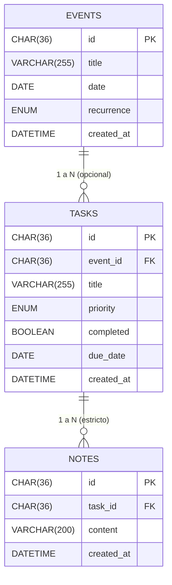

# 🗄️ Arquitectura de Persistencia, Base de Datos y Contenerización

Este documento detalla la infraestructura técnica, el flujo de configuración, las decisiones de diseño y los patrones arquitectónicos aplicados para la persistencia y despliegue de **CLI-Agenda**.

---

## 1. Modelo de Datos y Esquema Relacional (`db/`)

La persistencia relacional está basada en **MySQL 8.0**. El esquema se inicializa de forma automatizada mediante scripts SQL numerados que garantizan el cumplimiento de las restricciones de integridad referencial:

* `db/01_events.sql`: Define la tabla raíz `events` (`id`, `title`, `date`, `recurrence`, `created_at`).
* `db/02_tasks.sql`: Define la tabla `tasks`, con clave foránea opcional `event_id` referenciando a `events(id)`.
* `db/03_notes.sql`: Define la tabla `notes`, con clave foránea obligatoria `task_id` referenciando a `tasks(id)`.

Reglas de Integridad:

ON DELETE CASCADE: Al eliminar un evento, la base de datos elimina automáticamente todas sus tareas asociadas; de forma análoga, al eliminar una tarea, se eliminan en cascada sus notas correspondientes, evitando registros huérfanos.

2. Decisiones de Diseño de Infraestructura: Docker y Configuración Híbrida
¿Por qué ejecutar la aplicación dentro de un contenedor Docker?
Entorno reproducible (Zero-Setup): Elimina el problema de versiones divergentes de Java o Maven entre máquinas de desarrollo. La compilación y ejecución se realizan en un entorno aislado e idéntico.

Aislamiento de red: La aplicación y el motor MySQL operan dentro de una red interna bridge gestionada por Docker Compose, comunicándose de forma segura mediante nombres de servicio DNS (mysql:3306).

Estrategia de Configuración Híbrida: Docker Primero, Fallback a Local (.properties)
La clase central ConnectionFactory implementa una estrategia de resolución en dos niveles:

Prioridad 1 (Contenedor / Producción): Intenta resolver las credenciales a través de variables de entorno del sistema (System.getenv()). En Docker Compose, estas se inyectan automáticamente (DB_HOST=mysql, DB_NAME=..., etc.).

Prioridad 2 (Entorno Local / IDE): Si no existen variables de entorno (como al ejecutar directamente Main.java desde IntelliJ IDEA), realiza un fallback leyendo src/main/resources/application.properties, el cual apunta a localhost:3306 (aprovechando el puerto expuesto del contenedor MySQL).

Gestión Segura de Credenciales (.env vs .env.example)

3. Patrones de Diseño Aplicados
A. Factory y Singleton (ConnectionFactory)
Singleton (sharedConnection): Mantiene una única conexión viva y reutilizable hacia el motor de base de datos para optimizar recursos y evitar la sobrecarga de aperturas/cierres constantes.

Factory: Centraliza y encapsula la lógica de instanciación del driver JDBC y la construcción de la cadena de conexión.

Control de Concurrencia (synchronized): Los métodos getConnection() y closeConnection() aseguran que la inicialización y el cierre sean seguros ante posibles llamadas concurrentes.

Tolerancia a Fallos: Mediante sharedConnection.isValid(2), la fábrica verifica proactivamente si la conexión sigue respondiendo antes de reutilizarla; si el socket se ha roto, restablece la conexión automáticamente.

B. Patrón DAO (Data Access Object) (*.dao)
Propósito: Separar de forma estricta las operaciones técnicas de SQL del resto del sistema.

Interfaces e Implementaciones:

TaskDAO → TaskDAOAdapter

NoteDAO → NoteDAOAdapter

EventDAO → EventDAOAdapter

Mapeo Relacional: Cada adaptador DAO se encarga exclusivamente de extraer tipos primitivos de SQL (ResultSet) y convertirlos en objetos de dominio mediante métodos de reconstrucción (Task.restore(...), Event.restore(...)).

C. Patrón Repository (*.repository)
Propósito: Ofrecer al dominio y a los servicios de negocio una interfaz semántica de colección de objetos (save, findById, deleteById), ocultando la tecnología de almacenamiento subyacente.

Semántica UPSERT: Las implementaciones DAOTaskRepository, DAONoteRepository y DAOEventRepository ejecutan una estrategia transparente:

java
if (!dao.update(entity)) {
    dao.insert(entity);
}
El servicio se desentiende de saber si la entidad es nueva o existente; simplemente invoca save().

Desacoplamiento total: Permite sustituir la persistencia SQL por persistencia en memoria (InRam...Repository) sin alterar una sola línea de lógica de negocio o de servicios.

4. Seguridad y Rendimiento en Capa de Datos
Prevención de Inyección SQL con PreparedStatement y Parámetros Parametrizados (?)
En todos los adaptadores DAO se rechaza la concatenación directa de cadenas en consultas SQL.

Uso de marcadores posicionales (?):

java
private static final String INSERT = 
    "INSERT INTO tasks (id, title, priority, completed, due_date, created_at) VALUES (?, ?, ?, ?, ?, ?)";
Mecanismo de seguridad: Los parámetros se envían al motor de base de datos de forma tipada mediante statement.setString(), statement.setDate(), etc. El driver de MySQL compila el árbol sintáctico de la consulta antes de recibir los valores del usuario, haciendo imposible que caracteres especiales (como ' OR '1'='1) alteren la semántica de la consulta.

Manejo de nulos seguro: Los valores opcionales (como due_date) se gestionan mediante comprobación explícita delegando en Types.DATE (statement.setNull(index, Types.DATE)).

Sincronización de Relaciones Unidireccionales en EventDAOAdapter
En el modelo relacional, la clave foránea se ubica en tasks.event_id, mientras que en el dominio, la agregación reside en el agregado raíz Event (List<EventTaskId>).

Para reconciliar esta diferencia sin introducir acoplamiento inverso en Task, EventDAOAdapter incorpora el método privado syncTasks(Connection, Event):

Desvincula asociaciones previas en la tabla tasks para ese evento (UPDATE tasks SET event_id = NULL WHERE event_id = ?).
Actualiza atómicamente las claves event_id en tasks correspondientes a la lista actual de tareas asociadas.
Al consultar eventos (findById o findAll), ejecuta una consulta auxiliar hacia tasks para cargar y reconstituir los identificadores asociados.

5. Especificación de Contenedores
docker-compose.yml
Servicio mysql:

Despliega la imagen oficial mysql:8.0.

Configura el juego de caracteres a utf8mb4 para soporte íntegro de caracteres internacionales.

Monta el volumen de datos persistente mysql-data en /var/lib/mysql.

Monta los scripts iniciales en /docker-entrypoint-initdb.d:ro.

Incorpora un healthcheck periódico mediante mysqladmin ping para determinar cuándo la base de datos está operativa.

Servicio app:

Compila la aplicación a partir del Dockerfile local.

Configurado con profiles: ["app"]: No arranca en segundo plano con up -d para evitar consumo innecesario de recursos; se ejecuta de forma interactiva bajo demanda.

Dependencia estricta depends_on con condición service_healthy: Impide que la aplicación intente conectar antes de que MySQL esté listo.

Habilita stdin_open: true y tty: true para permitir la interacción completa mediante consola interactiva (CLI).

Dockerfile (Multi-Stage Build)
Se implementa una construcción en dos etapas para optimizar seguridad y tamaño:

Etapa 1 (build – maven:3.9-eclipse-temurin-25):

Copia pom.xml y ejecuta mvn dependency:go-offline para cachear dependencias en capas de Docker.

Compila el código fuente (mvn clean package -DskipTests) y extrae las dependencias de tiempo de ejecución en ./target/dependency.

Etapa 2 (runtime – eclipse-temurin:25-jre):

Descarta el JDK, Maven y el código fuente.

Copia exclusivamente el binario app.jar y la carpeta lib/.

Define el punto de entrada con ENTRYPOINT ["java", "-cp", "app.jar:lib/*", "Main"].

Resultado: Reducción drástica del tamaño de la imagen y mitigación de vulnerabilidades al excluir herramientas de compilación del entorno de ejecución.
