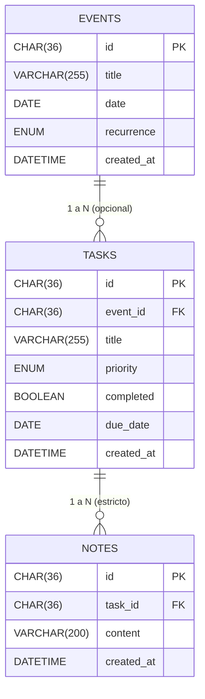

# CLI-Agenda

Aplicación de gestión de eventos, tareas y notas con persistencia en MySQL 8.0, contenerizada con Docker Compose y ejecutable tanto desde el IDE como dentro de Docker.

---

## 📑 Tabla de contenidos

1. [Requisitos previos](#-requisitos-previos)
2. [Inicio rápido](#-inicio-rápido)
3. [Persistencia de datos](#-persistencia-de-datos)
4. [Comandos útiles](#-comandos-útiles)
5. [Arquitectura](#-arquitectura)
6. [Modelo de datos](#-modelo-de-datos)
7. [Patrones de diseño](#-patrones-de-diseño)

---

## ✅ Requisitos previos

- **Docker Desktop** (con el motor en estado *Engine running*)
- **JDK 25** y **Maven 3.9+** (solo si ejecutas la app fuera de Docker, es decir, desde IntelliJ)
- Puerto **3306** libre en el host

---

## 🚀 Inicio rápido

Configuración de credenciales previa a la ejecución (**una sola vez**):

```bash
cp .env.example .env
cp src/main/resources/application.properties.example src/main/resources/application.properties
```

> ⚠️ `.env` y `application.properties` deben tener los **mismos valores** de credenciales. Ambos están excluidos de Git por `.gitignore`.

---

## 💾 Persistencia de datos

Los datos se almacenan en el **volumen Docker `mysql-data`**, independiente del ciclo de vida del contenedor:

| Comando                          | ¿Borra los datos? |
| -------------------------------- | ----------------- |
| `docker compose stop`            | ❌ No             |
| `docker compose down`            | ❌ No             |
| `docker compose down -v`         | ✅ **Sí**         |

Para hacer un backup:

```bash
docker exec agenda-mysql mysqldump -u root -p"$MYSQL_ROOT_PASSWORD" "$MYSQL_DATABASE" > backup.sql
```

---

## 🛠️ Comandos útiles

| Acción                                       | Comando                                |
| -------------------------------------------- | -------------------------------------- |
| Levantar solo MySQL                          | `docker compose up -d mysql`           |
| Ejecutar la app interactiva en Docker        | `docker compose run --rm --build app`  |
| Ver estado de los servicios                  | `docker compose ps`                    |
| Logs en vivo de MySQL                        | `docker compose logs -f mysql`         |
| Detener contenedores (conserva datos)        | `docker compose down`                  |
| Resetear la BD (borra volumen)               | `docker compose down -v`               |

---

## 🏗️ Arquitectura

### Servicios (`docker-compose.yml`)

- **`mysql`** — Imagen oficial `mysql:8.0`, charset `utf8mb4`, volumen persistente `mysql-data`, scripts de inicialización montados desde `./db`, `healthcheck` con `mysqladmin ping`.
- **`app`** — Perfil `"app"`, depende de `mysql` con `service_healthy`, `stdin_open` + `tty` para CLI interactiva.

### Imagen multi-stage (`Dockerfile`)

1. **Build** (`maven:3.9-eclipse-temurin-25`) — cachea dependencias con `dependency:go-offline`, compila y extrae dependencias en `target/dependency`.
2. **Runtime** (`eclipse-temurin:25-jre`) — solo incluye `app.jar` y `lib/`, sin JDK ni Maven. `ENTRYPOINT` ejecuta `java -cp "app.jar:lib/*" Main`.

Resultado: imagen final mínima, sin herramientas de compilación.

### Configuración híbrida

`ConnectionFactory` resuelve credenciales en dos niveles:

1. **Variables de entorno** (`System.getenv()`) — prioridad alta, usadas en Docker Compose.
2. **`application.properties`** — fallback para ejecución local desde IDE (`localhost:3306`).

---

## 🗃️ Modelo de datos



Los scripts en `db/` (`01_events.sql`, `02_tasks.sql`, `03_notes.sql`) se ejecutan automáticamente al inicializar el volumen y aplican `ON DELETE CASCADE` para evitar registros huérfanos.

---
